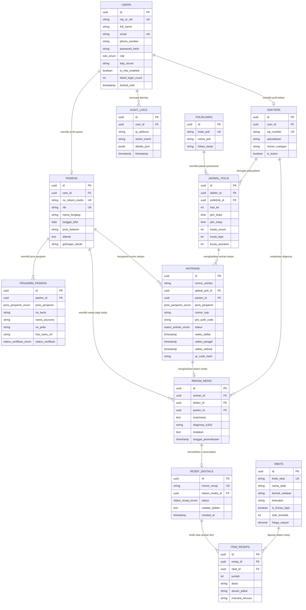

# Perancangan Basis Data (ERD & Skema PostgreSQL)
## Sistem Informasi Manajemen Rumah Sakit (SIMRS) RS Mahardika Cirebon

* **Mata Kuliah:** Analisis dan Perancangan Sistem (Praktikum Semester 5)
* **Dokumen Acuan:** PRD v1.2 (`prd_simrs_rs_mahardika_cirebon (gemini).md`)
* **Database Engine:** PostgreSQL 15+ & Caching Redis
* **Tanggal:** 11 November 2026

---

## 1. Entity-Relationship Diagram (ERD)

Diagram ERD konseptual dan relasional antar-entitas data SIMRS RS Mahardika Cirebon:



---

## 2. Kamus Data (Data Dictionary)

### 2.1 Tipe Data Enumerasi (Custom PostgreSQL Enums)

1. **`role_enum`**: `'PASIEN'`, `'DOKTER'`, `'ADMIN_PENDAFTARAN'`, `'ADMIN_FARMASI'`, `'SUPER_ADMIN'`
2. **`jenis_penjamin_enum`**: `'UMUM'`, `'BPJS'`, `'ASURANSI_SWASTA'`
3. **`status_verifikasi_enum`**: `'PENDING'`, `'TERVERIFIKASI'`, `'DITOLAK'`
4. **`status_antrian_enum`**: `'MENUNGGU'`, `'DIPANGGIL'`, `'SEDANG_DIPERIKSA'`, `'SELESAI'`, `'BATAL'`
5. **`status_resep_enum`**: `'DRAF'`, `'TERKIRIM_FARMASI'`, `'SEDANG_DIRACIK'`, `'SIAP_DISERAHKAN'`, `'DISPENSED'`

---

### 2.2 Spesifikasi Tabel Relasional

#### 1. Tabel: `users`
Menyimpan data otentikasi sentral untuk seluruh peran pengguna sistem.
* `id` (UUID, Primary Key, Auto Gen UUID v4)
* `nip_or_nik` (VARCHAR(30), Unique, Not Null) — NIP untuk staf, NIK untuk pasien.
* `full_name` (VARCHAR(150), Not Null)
* `email` (VARCHAR(100), Unique, Nullable)
* `phone_number` (VARCHAR(20), Nullable) — Digunakan untuk pengiriman OTP WhatsApp.
* `password_hash` (VARCHAR(255), Not Null) — Hash Argon2id / bcrypt.
* `role` (role_enum, Not Null)
* `totp_secret` (VARCHAR(100), Nullable) — Kunci rahasia Google Authenticator MFA.
* `is_mfa_enabled` (BOOLEAN, Default False) — Wajib TRUE untuk DOKTER dan ADMIN.
* `failed_login_count` (INT, Default 0) — Proteksi brute force (kunci jika $\ge 5$).
* `locked_until` (TIMESTAMP WITH TIME ZONE, Nullable)
* `created_at`, `updated_at` (TIMESTAMP WITH TIME ZONE)

#### 2. Tabel: `antrians`
Menyimpan state perjalanan antrian pasien secara real-time.
* `id` (UUID, Primary Key)
* `nomor_antrian` (VARCHAR(10), Not Null) — Contoh: `B-015`, `U-008`, `A-003`.
* `jadwal_poli_id` (UUID, FK -> `jadwal_polis.id`, Not Null)
* `pasien_id` (UUID, FK -> `pasiens.id`, Not Null)
* `jenis_penjamin` (jenis_penjamin_enum, Not Null)
* `nomor_sep` (VARCHAR(50), Nullable) — Nomor SEP VClaim jika BPJS.
* `pre_auth_code` (VARCHAR(50), Nullable) — Nomor pre-authorization jika Asuransi Swasta.
* `status` (status_antrian_enum, Default `'MENUNGGU'`)
* `waktu_daftar` (TIMESTAMP WITH TIME ZONE, Default NOW())
* `waktu_panggil` (TIMESTAMP WITH TIME ZONE, Nullable)
* `waktu_selesai` (TIMESTAMP WITH TIME ZONE, Nullable)
* `qr_code_hash` (VARCHAR(255), Not Null)

#### 3. Tabel: `jadwal_polis`
Menyimpan kuota layanan per hari yang dipisahkan antar penjamin sesuai Modul 4.4 PRD.
* `id` (UUID, Primary Key)
* `dokter_id` (UUID, FK -> `dokters.id`, Not Null)
* `poliklinik_id` (UUID, FK -> `polikliniks.id`, Not Null)
* `hari_ke` (INT, 1=Senin s/d 7=Minggu)
* `jam_buka` (TIME, Not Null)
* `jam_tutup` (TIME, Not Null)
* `kuota_umum` (INT, Default 10)
* `kuota_bpjs` (INT, Default 15)
* `kuota_asuransi` (INT, Default 5)

#### 4. Tabel: `resep_digitals` & `item_reseps`
Digitalisasi peresepan dari dokter ke farmasi secara terintegrasi (E-Prescription).
* `nomor_resep` (VARCHAR(30), Unique) — Contoh: `#RX-20261111-008`.
* `status` (status_resep_enum) — Pergerakan status dari dokter ke loket obat.

---

## 3. Skrip DDL Lengkap (PostgreSQL Schema)

Berikut adalah kode DDL SQL yang siap dieksekusi di database PostgreSQL:

```sql
-- ========================================================
-- SIMRS RS MAHARDIKA CIREBON - DATABASE DDL SCHEMA
-- Target Database: PostgreSQL 15+
-- ========================================================

-- 1. EXTENSIONS
CREATE EXTENSION IF NOT EXISTS "uuid-ossp";

-- 2. ENUMERATIONS
CREATE TYPE role_enum AS ENUM (
    'PASIEN', 
    'DOKTER', 
    'ADMIN_PENDAFTARAN', 
    'ADMIN_FARMASI', 
    'SUPER_ADMIN'
);

CREATE TYPE jenis_penjamin_enum AS ENUM (
    'UMUM', 
    'BPJS', 
    'ASURANSI_SWASTA'
);

CREATE TYPE status_verifikasi_enum AS ENUM (
    'PENDING', 
    'TERVERIFIKASI', 
    'DITOLAK'
);

CREATE TYPE status_antrian_enum AS ENUM (
    'MENUNGGU', 
    'DIPANGGIL', 
    'SEDANG_DIPERIKSA', 
    'SELESAI', 
    'BATAL'
);

CREATE TYPE status_resep_enum AS ENUM (
    'DRAF', 
    'TERKIRIM_FARMASI', 
    'SEDANG_DIRACIK', 
    'SIAP_DISERAHKAN', 
    'DISPENSED'
);

-- 3. TABEL: USERS
CREATE TABLE users (
    id UUID PRIMARY KEY DEFAULT uuid_generate_v4(),
    nip_or_nik VARCHAR(30) UNIQUE NOT NULL,
    full_name VARCHAR(150) NOT NULL,
    email VARCHAR(100) UNIQUE,
    phone_number VARCHAR(20),
    password_hash VARCHAR(255) NOT NULL,
    role role_enum NOT NULL DEFAULT 'PASIEN',
    totp_secret VARCHAR(100),
    is_mfa_enabled BOOLEAN NOT NULL DEFAULT FALSE,
    failed_login_count INT NOT NULL DEFAULT 0,
    locked_until TIMESTAMP WITH TIME ZONE,
    created_at TIMESTAMP WITH TIME ZONE DEFAULT CURRENT_TIMESTAMP,
    updated_at TIMESTAMP WITH TIME ZONE DEFAULT CURRENT_TIMESTAMP
);

-- 4. TABEL: PASIENS
CREATE TABLE pasiens (
    id UUID PRIMARY KEY DEFAULT uuid_generate_v4(),
    user_id UUID REFERENCES users(id) ON DELETE CASCADE,
    no_rekam_medis VARCHAR(20) UNIQUE NOT NULL,
    nik CHAR(16) UNIQUE NOT NULL,
    nama_lengkap VARCHAR(150) NOT NULL,
    tanggal_lahir DATE NOT NULL,
    jenis_kelamin CHAR(1) CHECK (jenis_kelamin IN ('L', 'P')),
    alamat TEXT NOT NULL,
    golongan_darah VARCHAR(3),
    created_at TIMESTAMP WITH TIME ZONE DEFAULT CURRENT_TIMESTAMP
);

-- 5. TABEL: PENJAMIN_PASIENS
CREATE TABLE penjamin_pasiens (
    id UUID PRIMARY KEY DEFAULT uuid_generate_v4(),
    pasien_id UUID NOT NULL REFERENCES pasiens(id) ON DELETE CASCADE,
    jenis_penjamin jenis_penjamin_enum NOT NULL,
    no_kartu VARCHAR(50),
    nama_asuransi VARCHAR(100),
    no_polis VARCHAR(50),
    foto_kartu_url TEXT,
    status_verifikasi status_verifikasi_enum DEFAULT 'PENDING',
    verified_by UUID REFERENCES users(id),
    created_at TIMESTAMP WITH TIME ZONE DEFAULT CURRENT_TIMESTAMP
);

-- 6. TABEL: POLIKLINIKS
CREATE TABLE polikliniks (
    id UUID PRIMARY KEY DEFAULT uuid_generate_v4(),
    kode_poli VARCHAR(10) UNIQUE NOT NULL,
    nama_poli VARCHAR(100) NOT NULL,
    lokasi_lantai VARCHAR(50) NOT NULL,
    created_at TIMESTAMP WITH TIME ZONE DEFAULT CURRENT_TIMESTAMP
);

-- 7. TABEL: DOKTERS
CREATE TABLE dokters (
    id UUID PRIMARY KEY DEFAULT uuid_generate_v4(),
    user_id UUID NOT NULL REFERENCES users(id) ON DELETE CASCADE,
    sip_number VARCHAR(50) UNIQUE NOT NULL,
    spesialisasi VARCHAR(100) NOT NULL,
    nomor_ruangan VARCHAR(20) NOT NULL,
    is_active BOOLEAN NOT NULL DEFAULT TRUE,
    created_at TIMESTAMP WITH TIME ZONE DEFAULT CURRENT_TIMESTAMP
);

-- 8. TABEL: JADWAL_POLIS
CREATE TABLE jadwal_polis (
    id UUID PRIMARY KEY DEFAULT uuid_generate_v4(),
    dokter_id UUID NOT NULL REFERENCES dokters(id) ON DELETE RESTRICT,
    poliklinik_id UUID NOT NULL REFERENCES polikliniks(id) ON DELETE RESTRICT,
    hari_ke INT NOT NULL CHECK (hari_ke BETWEEN 1 AND 7), -- 1: Senin, 7: Minggu
    jam_buka TIME NOT NULL,
    jam_tutup TIME NOT NULL,
    kuota_umum INT NOT NULL DEFAULT 10,
    kuota_bpjs INT NOT NULL DEFAULT 15,
    kuota_asuransi INT NOT NULL DEFAULT 5,
    created_at TIMESTAMP WITH TIME ZONE DEFAULT CURRENT_TIMESTAMP
);

-- 9. TABEL: ANTRIANS
CREATE TABLE antrians (
    id UUID PRIMARY KEY DEFAULT uuid_generate_v4(),
    nomor_antrian VARCHAR(10) NOT NULL,
    jadwal_poli_id UUID NOT NULL REFERENCES jadwal_polis(id) ON DELETE RESTRICT,
    pasien_id UUID NOT NULL REFERENCES pasiens(id) ON DELETE RESTRICT,
    jenis_penjamin jenis_penjamin_enum NOT NULL,
    nomor_sep VARCHAR(50),
    pre_auth_code VARCHAR(50),
    status status_antrian_enum NOT NULL DEFAULT 'MENUNGGU',
    waktu_daftar TIMESTAMP WITH TIME ZONE DEFAULT CURRENT_TIMESTAMP,
    waktu_panggil TIMESTAMP WITH TIME ZONE,
    waktu_selesai TIMESTAMP WITH TIME ZONE,
    qr_code_hash VARCHAR(255) NOT NULL,
    created_at TIMESTAMP WITH TIME ZONE DEFAULT CURRENT_TIMESTAMP
);

-- 10. TABEL: REKAM_MEDIS
CREATE TABLE rekam_medis (
    id UUID PRIMARY KEY DEFAULT uuid_generate_v4(),
    antrian_id UUID UNIQUE NOT NULL REFERENCES antrians(id) ON DELETE RESTRICT,
    dokter_id UUID NOT NULL REFERENCES dokters(id) ON DELETE RESTRICT,
    pasien_id UUID NOT NULL REFERENCES pasiens(id) ON DELETE RESTRICT,
    anamnesa TEXT NOT NULL,
    diagnosa_icd10 VARCHAR(20) NOT NULL,
    tindakan TEXT,
    tanggal_pemeriksaan TIMESTAMP WITH TIME ZONE DEFAULT CURRENT_TIMESTAMP
);

-- 11. TABEL: OBATS
CREATE TABLE obats (
    id UUID PRIMARY KEY DEFAULT uuid_generate_v4(),
    kode_obat VARCHAR(20) UNIQUE NOT NULL,
    nama_obat VARCHAR(150) NOT NULL,
    bentuk_sediaan VARCHAR(50) NOT NULL,
    kekuatan VARCHAR(50),
    is_fornas_bpjs BOOLEAN NOT NULL DEFAULT FALSE,
    stok_tersedia INT NOT NULL DEFAULT 0 CHECK (stok_tersedia >= 0),
    harga_satuan DECIMAL(12, 2) NOT NULL DEFAULT 0.00,
    created_at TIMESTAMP WITH TIME ZONE DEFAULT CURRENT_TIMESTAMP
);

-- 12. TABEL: RESEP_DIGITALS
CREATE TABLE resep_digitals (
    id UUID PRIMARY KEY DEFAULT uuid_generate_v4(),
    nomor_resep VARCHAR(30) UNIQUE NOT NULL,
    rekam_medis_id UUID UNIQUE NOT NULL REFERENCES rekam_medis(id) ON DELETE RESTRICT,
    status status_resep_enum NOT NULL DEFAULT 'DRAF',
    catatan_dokter TEXT,
    created_at TIMESTAMP WITH TIME ZONE DEFAULT CURRENT_TIMESTAMP,
    updated_at TIMESTAMP WITH TIME ZONE DEFAULT CURRENT_TIMESTAMP
);

-- 13. TABEL: ITEM_RESEPS
CREATE TABLE item_reseps (
    id UUID PRIMARY KEY DEFAULT uuid_generate_v4(),
    resep_id UUID NOT NULL REFERENCES resep_digitals(id) ON DELETE CASCADE,
    obat_id UUID NOT NULL REFERENCES obats(id) ON DELETE RESTRICT,
    jumlah INT NOT NULL CHECK (jumlah > 0),
    dosis VARCHAR(50) NOT NULL,
    aturan_pakai VARCHAR(100) NOT NULL,
    instruksi_khusus TEXT,
    created_at TIMESTAMP WITH TIME ZONE DEFAULT CURRENT_TIMESTAMP
);

-- 14. TABEL: AUDIT_LOGS
CREATE TABLE audit_logs (
    id UUID PRIMARY KEY DEFAULT uuid_generate_v4(),
    user_id UUID REFERENCES users(id) ON DELETE SET NULL,
    ip_address VARCHAR(45) NOT NULL,
    action_event VARCHAR(100) NOT NULL,
    details_json JSONB,
    created_at TIMESTAMP WITH TIME ZONE DEFAULT CURRENT_TIMESTAMP
);

-- ========================================================
-- INDEX OPTIMIZATIONS (PERFORMANCE REQUIREMENT <500ms)
-- ========================================================
CREATE INDEX idx_users_nip_or_nik ON users(nip_or_nik);
CREATE INDEX idx_antrians_status_waktu ON antrians(status, waktu_daftar);
CREATE INDEX idx_antrians_jadwal_poli ON antrians(jadwal_poli_id);
CREATE INDEX idx_resep_status ON resep_digitals(status);
CREATE INDEX idx_audit_logs_user_time ON audit_logs(user_id, created_at);
```

---

Dengan perancangan ERD dan skema basis data PostgreSQL ini, arsitektur data SIMRS RS Mahardika Cirebon telah lengkap dan siap untuk diintegrasikan dengan modul API backend dan antarmuka frontend.

