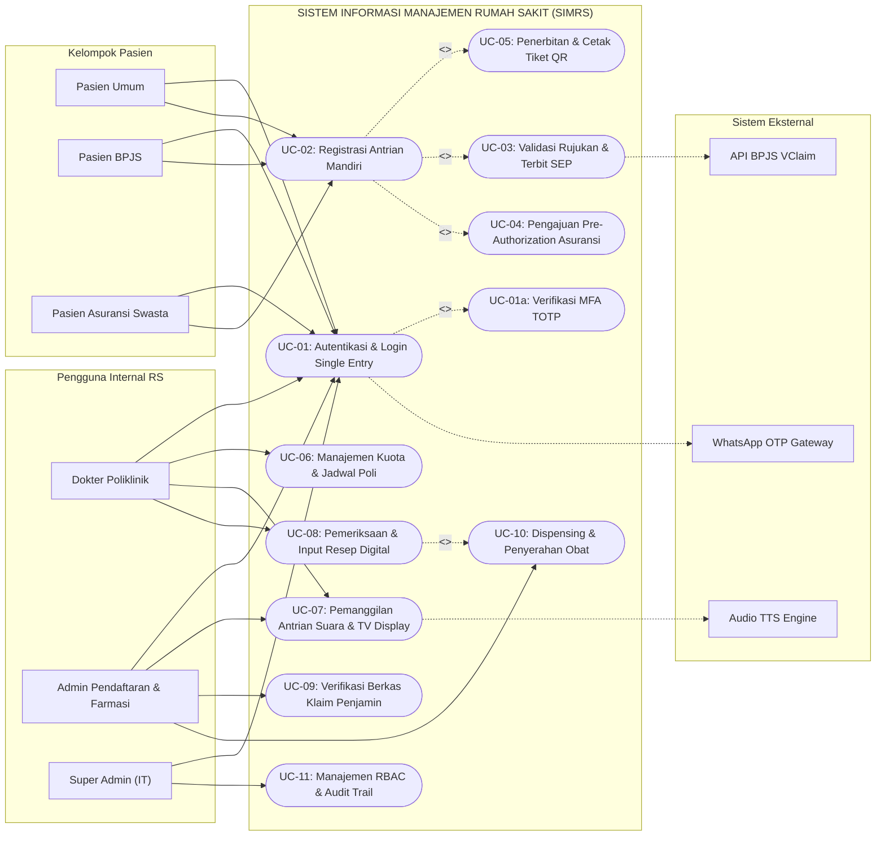
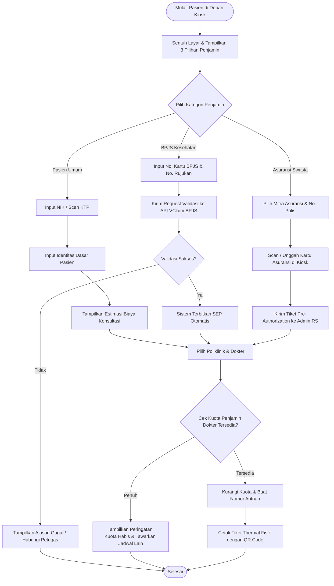
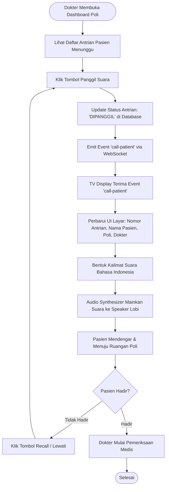
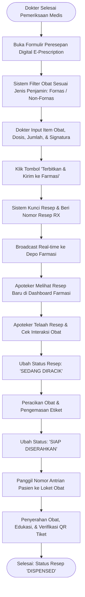
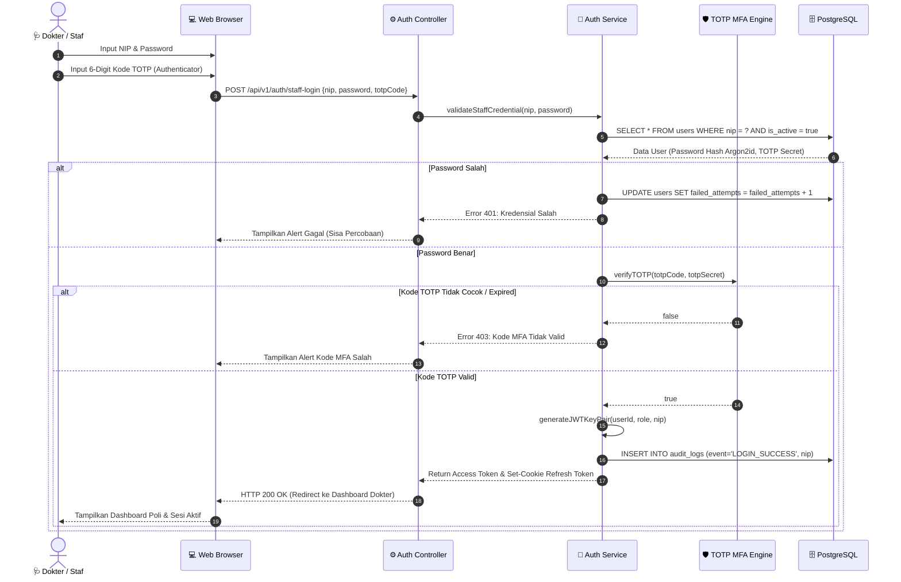
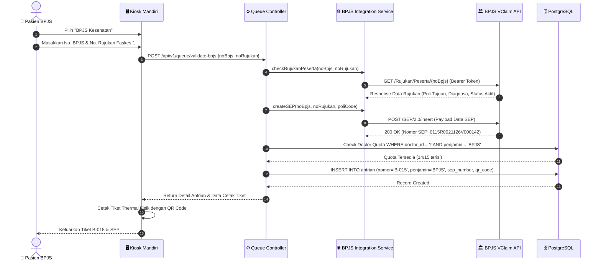
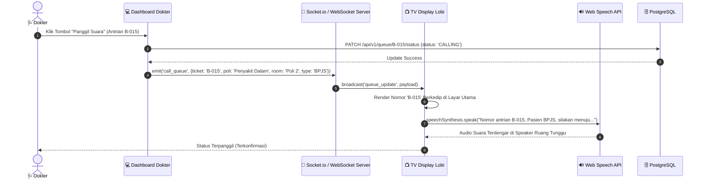
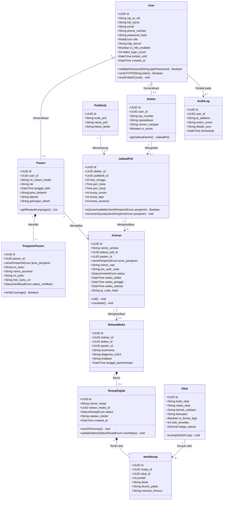

# Dokumen Pemodelan UML (Unified Modeling Language)
## Sistem Informasi Manajemen Rumah Sakit (SIMRS) RS Mahardika Cirebon

* **Mata Kuliah:** Analisis dan Perancangan Sistem (Praktikum Semester 5)
* **Dokumen Acuan:** PRD v1.2 (`prd_simrs_rs_mahardika_cirebon (gemini).md`)
* **Versi Dokumen:** v1.0
* **Tanggal:** 11 November 2026

---

## 1. Identifikasi Aktor & Peran Sistem

Berdasarkan matriks pengguna pada PRD, aktor yang berinteraksi dengan SIMRS RS Mahardika Cirebon diklasifikasikan sebagai berikut:

| Simbol Aktor | Nama Aktor | Deskripsi Peran & Tanggung Jawab |
|---|---|---|
| 👤 | **Pasien Umum** | Mendaftar mandiri via Kiosk/Portal Pasien dengan skema pembayaran tunai/mandiri (*Self-Pay*). |
| 🏥 | **Pasien BPJS** | Mendaftar menggunakan NIK/No. Kartu BPJS dan rujukan Faskes 1 untuk verifikasi SEP otomatis. |
| 🛡️ | **Pasien Asuransi** | Mendaftar menggunakan kartu asuransi swasta mitra dan mengajukan *pre-authorization*. |
| 🩺 | **Dokter Spesialis/Umum** | Mengelola jadwal/kuota penjamin, memanggil antrian, dan menginput resep digital (*E-Prescription*). |
| 📋 | **Admin Pendaftaran & Farmasi** | Memverifikasi fisik/digital berkas klaim, mengontrol antrian, dan meracik/menyerahkan obat. |
| 🔐 | **Super Admin (IT)** | Mengelola hak akses berbasis peran (*RBAC*), memantau *audit trail*, dan integritas database. |
| ⚙️ | **Sistem Eksternal BPJS VClaim** | Web service eksternal BPJS Kesehatan untuk validasi kepesertaan, nomor rujukan, dan penerbitan SEP. |
| 💬 | **Gateway WhatsApp & SMS** | Layanan eksternal penyedia pengiriman OTP verifikasi login dan reminder antrian. |
| 🔊 | **Audio Synthesizer (TTS)** | Layanan *Web Speech API* untuk pemanggilan nomor antrian suara otomatis berbahasa Indonesia. |

---

## 2. Use Case Diagram

### 2.1 Visualisasi Use Case Diagram

---

### 2.2 Skenario Use Case Spesifik (Use Case Specifications)

#### Skenario 1: UC-02 & UC-03 (Registrasi Antrian Mandiri Pasien BPJS)
* **Use Case ID:** UC-02 / UC-03
* **Aktor Utama:** Pasien BPJS
* **Aktor Sekunder:** API BPJS VClaim
* **Pre-Condition:** Pasien memiliki Kartu BPJS aktif dan surat rujukan Faskes 1 (Puskesmas/Klinik) yang masih berlaku (maks. 90 hari).
* **Main Success Scenario (Alur Utama):**
  1. Pasien memilih opsi **"BPJS Kesehatan"** di Kiosk Pendaftaran Mandiri.
  2. Sistem menampilkan form input Nomor Kartu BPJS / NIK dan Nomor Surat Rujukan.
  3. Pasien menginput nomor rujukan (atau memindai barcode rujukan).
  4. Sistem mengirim request validasi kepesertaan dan rujukan ke API BPJS VClaim.
  5. API BPJS VClaim merespons status data valid dan mengembalikan nomor SEP (*Surat Elegibilitas Peserta*).
  6. Sistem menampilkan daftar poliklinik dan dokter spesialis sesuai rujukan.
  7. Pasien memilih dokter spesialis dan jam kunjungan.
  8. Sistem memeriksa kuota harian BPJS untuk dokter tersebut (tersedia).
  9. Sistem menerbitkan tiket antrian berawalan huruf "B" (contoh: `B-015`) beserta QR Code.
  10. Kiosk mencetak tiket fisik thermal dan menyimpan state antrian ke database.
* **Alternative Scenario (Alur Alternatif - Kuota Penuh):**
  * 8a. Kuota dokter untuk pasien BPJS telah penuh (misal: 15/15 kuota telah habis).
  * 8b. Sistem menampilkan pemberitahuan kuota penuh dan merekomendasikan pilihan dokter spesialis lain atau jadwal hari berikutnya.
* **Post-Condition:** Data antrian tercatat di sistem dengan status penjamin *BPJS Kesehatan* dan tiket fisik diterima pasien.

---

#### Skenario 2: UC-07 (Pemanggilan Antrian Suara & TV Display)
* **Use Case ID:** UC-07
* **Aktor Utama:** Dokter Poliklinik / Perawat
* **Aktor Sekunder:** TV Display Lobi, Audio TTS Engine
* **Pre-Condition:** Terdapat antrian pasien yang berstatus *Menunggu* pada poliklinik aktif.
* **Main Success Scenario (Alur Utama):**
  1. Dokter membuka dashboard poliklinik dan melihat daftar pasien menunggu.
  2. Dokter menekan tombol **"Panggil Suara"** pada nomor antrian teratas (misal: `B-015`).
  3. Sistem mengubah status antrian menjadi *Sedang Diperiksa* dan memancarkan event WebSocket ke server.
  4. Server WebSocket menyiarkan pesan ke seluruh TV Display ruang tunggu lobi.
  5. TV Display memperbarui nomor aktif di layar menjadi `B-015`, nama poli, dan nama dokter.
  6. TV Display memicu *Web Speech API Synthesizer* berbahasa Indonesia untuk menyuarakan:
     > *"Nomor antrian B-015, Pasien BPJS, silakan menuju Poliklinik Penyakit Dalam RS Mahardika Cirebon, Ruang Poli 2."*
  7. Pasien di ruang tunggu mendengar panggilan dan masuk ke ruangan poli yang dituju.
* **Alternative Scenario (Pasien Tidak Hadir / Panggil Ulang):**
  * 6a. Pasien belum masuk setelah 3 menit.
  * 6b. Dokter menekan tombol **"Panggil Ulang (Recall)"**.
  * 6c. Sistem memicu kembali pemanggilan audio suara ke speaker lobi.
* **Post-Condition:** Pasien masuk ke ruang poli dan status antrian tercatat di audit trail.

---

#### Skenario 3: UC-08 & UC-10 (Peresepan Obat Digital & Sinkronisasi Farmasi)
* **Use Case ID:** UC-08 / UC-10
* **Aktor Utama:** Dokter Poliklinik
* **Aktor Sekunder:** Admin/Apoteker Depo Farmasi
* **Pre-Condition:** Pasien sedang dalam sesi pemeriksaan medis aktif oleh dokter.
* **Main Success Scenario (Alur Utama):**
  1. Dokter menyelesaikan diagnosa dan membuka panel **E-Prescription**.
  2. Sistem menampilkan daftar formularium obat (tersaring otomatis sesuai kriteria Fornas BPJS untuk pasien BPJS).
  3. Dokter memilih obat, menentukan dosis, jumlah, aturan pakai, dan catatan khusus.
  4. Dokter menekan tombol **"Terbitkan & Kirim ke Farmasi"**.
  5. Sistem memvalidasi resep, mengunci draf resep, dan menerbitkan nomor resep digital (contoh: `#RX-20261111-008`).
  6. Melalui koneksi real-time, order resep langsung muncul di layar Depo Farmasi dengan status *Resep Masuk*.
  7. Apoteker farmasi menerima resep, menyiapkan/meracik obat, dan mengubah status menjadi *Siap Diserahkan*.
  8. Sistem mengirim notifikasi nomor antrian pengambilan obat ke TV Display Farmasi dan akun pasien.
  9. Pasien menyerahkan tiket/QR code di loket obat dan menerima obat beserta konseling apoteker.
* **Post-Condition:** Resep terselesaikan (*Dispensed*), stok obat berkurang otomatis, dan data resep tersimpan di rekam medis elektronik.

---

## 3. Activity Diagram

### 3.1 Activity Diagram 1: Alur Triage Penjamin Biaya pada Kiosk Pendaftaran

---

### 3.2 Activity Diagram 2: Alur Pemanggilan Antrian Suara (TTS) & TV Display

---

### 3.3 Activity Diagram 3: Alur Peresepan Digital (E-Prescription) & Farmasi

---

## 4. Sequence Diagram

### 4.1 Sequence Diagram 1: Autentikasi Pengguna Medis dengan MFA (TOTP)

---

### 4.2 Sequence Diagram 2: Pendaftaran Pasien BPJS & Validasi VClaim SEP

---

### 4.3 Sequence Diagram 3: Pemanggilan Antrian Real-Time & Text-to-Speech

---

## 5. Class Diagram (Struktur Kelas & Domain Model)

---

Dokumen pemodelan UML di atas telah memenuhi spesifikasi analisis sistem untuk implementasi basis data dan arsitektur kode program SIMRS RS Mahardika Cirebon.

